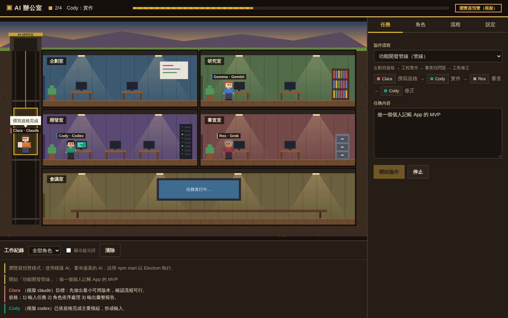
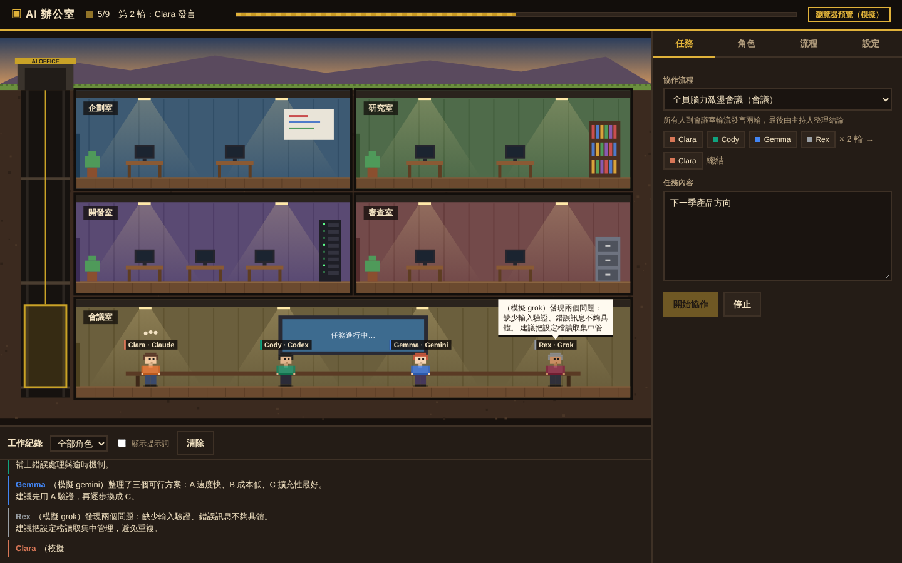

# AI 辦公室

用「避難所剖面」2D 視角呈現的 AI 協作辦公室。每個 AI 是一位有名字、職稱、外觀與個性設定的員工，住在不同房間；下任務後，他們會依流程搭電梯交件、到會議室開會，你在畫面上看得到誰在思考、誰在寫東西、誰把文件交給誰。





- **多 AI 串接**：Claude、Codex、Gemini 用本機 CLI（沿用你已登入的帳號），Grok 用 xAI API；每個角色都能自由切換 CLI / API。
- **兩種協作流程**：固定管線（企劃 → 工程 → 審查 → 修正）與會議討論（輪流發言，主持人總結）。
- **角色設定**：名字、職稱、引擎、模型、房間、膚色髮色服裝、系統提示詞，都在 App 內編輯。
- **模擬模式**：預設開啟，不需任何金鑰就能先看動畫與流程。
- **報告存檔**：每次任務的完整過程存成 Markdown，放在工作目錄的 `runs/`。

## 快速開始（Windows）

1. 到 https://nodejs.org 安裝 Node.js（選 LTS 版）。
2. 把 ai-office 資料夾放在固定位置（例如「文件」），雙擊 `install-windows.bat`。
3. 桌面和開始功能表會出現「AI Office」，之後雙擊它就會開啟獨立的辦公室視窗。

說明：
- 視窗用 Windows 內建的 Edge「應用程式模式」開啟：沒有網址列和分頁，工作列上是自己的圖示。沒有 Edge 時改用 Chrome，兩者都沒有才用預設瀏覽器。
- 關掉視窗約 10 秒後，背景服務會自動結束；重複點捷徑不會開出第二份服務。
- 打不開時，雙擊 `start-windows.bat`，黑色視窗會顯示詳細錯誤；記錄也會寫在使用者資料夾的 `.ai-office/server.log`。
- Mac 請雙擊 `start-mac.command`。設定與金鑰存在使用者資料夾的 `.ai-office/` 裡。

**進階：桌面視窗版（Electron）**：`npm install` 後執行 `npm run electron`，需要能下載 Electron；金鑰會用系統金鑰圈加密。

```bash
npm test           # 核心測試
npm run check-cli  # 檢查本機 claude / codex / gemini 是否可用
```

## 企劃先追問、隨時追加指示

- **先追問再動工**：「任務」分頁勾選「開始前讓企劃先追問、確認需求」（預設開啟）。企劃會先判斷需求夠不夠清楚，不清楚就跳出最多 4 個問題，多半附選項可以直接點，也能補充說明；需要時會再追問一輪。你的回答會併進任務，後面每位成員都看得到。也可以按「跳過，直接開始」。
- **隨時追加指示**：任務進行中，「任務」分頁會出現「追加指示」欄位。送出後，下一位開始工作的成員就會照著調整（正在工作的那位不受影響）。
- **改版也一樣**：「改版」分頁開始後，企劃會先追問；進行中可以追加指示；改版完成、還沒發布前，可以用「追加修改」讓工程在目前的修改上接著改，並重新測試與審查。

## 白板與專案總覽

- **處室白板**：每個處室牆上都有白板，顯示待辦／進行／卡住／完成的數量與進度。點一下就會打開看板，可以新增任務、指派負責人、拉進度、標記卡住並寫原因。
- **會議室總覽**：會議室的大螢幕把所有任務整理成「專案卡」，顯示整體進度、各處室完成數，以及卡在哪個處室、哪個人、哪一步。
- **單一資料來源**：白板和總覽讀同一份 `.ai-office/tasks.json`。跑流程時，系統會自動建立專案、替每一步在負責角色的處室開任務並即時更新進度；中途出錯或停止，該步會標成「卡住」並寫上原因。

## 剩餘用量

每次打開右側「用量」分頁都會即時向各家查一次（Gemini 會請 agy-hud 重新抓取）；角色名牌下的小條（綠＝充足、黃＝偏少、紅＝快用完）：

| AI | 怎麼查 | 顯示內容 |
|---|---|---|
| Claude（CLI） | 讀 Claude Code 的登入資訊，查詢訂閱用量（非官方介面，日後可能失效） | 5 小時／7 天剩餘百分比與重置時間 |
| Codex（CLI） | 即時呼叫 Codex 官方的 `codex app-server` 查詢；失敗時改讀本機工作紀錄 | 5 小時／每週剩餘百分比與重置時間 |
| Gemini（Antigravity） | Google 未提供公開查詢方式。若你自行安裝第三方工具 [agy-hud](https://github.com/icebear0828/agy-hud)，AI Office 會讀它寫在本機的額度快取（只讀檔案，不碰你的登入資訊） | 5 小時／每週剩餘百分比（取最吃緊的模型）；沒裝 agy-hud 時只顯示今日呼叫次數 |
| Grok（API） | 依回應的 token 數 × 單價 | 本月估計花費（美元）與 token 數 |

## 自動更新

AI Office 會從 GitHub 倉庫 [MAO-96/ai-office](https://github.com/MAO-96/ai-office) 更新：

- 每次開啟會在背景檢查，有新版時右上角出現綠色「有新版本 ▸ 更新」按鈕，也可以到「設定 → 版本與更新」手動檢查。
- 按下更新：下載新版、覆蓋程式檔案、自動重啟並重新載入畫面，不用重新安裝。
- 角色、流程、金鑰、報告都存在使用者資料夾的 `.ai-office/`，更新不會動到。
- 有任務正在跑時不能更新，請等任務完成或先停止。

**發布新版**（給開發者）：修改程式後，把 `package.json` 的 `version` 調高（例如 0.2.0 → 0.2.1），可在 `aiOffice.notes` 寫一句新版內容，推送到 `main` 分支即可。引擎設定有變動時，把 `config/engines.json` 的 `_version` 也加一，使用者端會自動套用。

## 自己改版（AI Office 改 AI Office）

到右側「改版」分頁，描述想要的新功能或修改，選好企劃、工程、審查成員，按「開始改版」：

1. **準備開發副本**：從 GitHub 下載最新原始碼到 `.ai-office/dev/ai-office`，和正在使用的 AI Office 分開，改壞不影響你。
2. **企劃寫規格** → **工程直接修改程式**（工程必須是 CLI 模式，例如 Claude 或 Codex；只在這個流程會開啟寫檔權限）。
3. **自動測試**：語法檢查、設定檔檢查、核心測試，並實際啟動一次伺服器。沒過會把錯誤交給工程修一輪再測。
4. **審查**：審查者看完整程式差異並給結論（審查失敗不會中斷，但會標示出來）。
5. **你確認**：在分頁裡看修改了哪些檔案、測試結果、審查意見與完整差異，按「發布到 GitHub」才會推上去；也可以放棄。
6. **更新**：發布後按「立即更新」或右上角更新按鈕即可套用。

**安全網**：每次更新前都會自動備份目前版本（保留最近 3 份）。萬一新版有問題，到「設定 → 版本與更新」按「回復上一版」。

**第一次發布前**：需要電腦上有 Git，並登入過你的 GitHub。第一次推送時 Git 會跳出 GitHub 登入視窗；若沒有出現，畫面會提示你在 PowerShell 手動執行一次推送指令完成登入。

## 串接各家 AI

| 角色預設 | 引擎 | 方式 | 需要準備 |
|---|---|---|---|
| Clara 企劃經理 | Claude | CLI | 安裝 Claude Code 並登入（`claude`） |
| Cody 資深工程師 | Codex | CLI | 安裝 Codex CLI 並登入（`codex`） |
| Gemma 研究與設計 | Gemini | CLI | 安裝 Gemini CLI 並登入（`gemini`） |
| Rex 審查官 | Grok | API | 在「設定」填 `XAI_API_KEY`，並在角色的「模型」欄填 xAI 的模型 ID |

- **CLI 模式**：提示詞從標準輸入送進 CLI（Windows 下也不會因換行或引號出錯），在「工作目錄」裡執行，所以 CLI 角色能直接讀寫那個資料夾的檔案。
- **API 模式**：金鑰優先讀環境變數（`ANTHROPIC_API_KEY`、`OPENAI_API_KEY`、`GEMINI_API_KEY`、`XAI_API_KEY`）；在 App 裡填的會用作業系統的金鑰圈加密後存在本機。API 模式的預設模型只有 Claude 有填，其他請到各家官方文件查目前的模型 ID，填在角色設定或 `engines.json` 的 `defaultModel`。
- **讓 CLI 能改檔案**：CLI 預設的權限較保守。若希望工程角色直接改檔，可在 `engines.json` 該引擎的 `args` 加上對應的自動核准參數（例如 Codex 的 `--full-auto`、Claude Code 的權限模式參數），參數名稱請以各 CLI 的 `--help` 為準。開啟後 AI 能在工作目錄裡寫檔與執行指令，建議工作目錄指到專門的資料夾或 git repo。

## 設定檔

第一次啟動時，`config/` 裡的預設設定會複製到使用者資料夾，之後在 App 裡的修改都存在那份；「設定 → 還原預設」可以重來。

| 檔案 | 內容 |
|---|---|
| `agents.json` | 角色：id、名字、職稱、引擎、串接方式、模型、房間、外觀、系統提示詞 |
| `engines.json` | 引擎：CLI 指令與參數、API 供應商、預設模型、金鑰名稱、代表色 |
| `rooms.json` | 樓層與房間：由上往下，每層最多兩間，`meeting` 為會議室 |
| `workflows.json` | 協作流程：`pipeline` 或 `meeting` |

流程提示詞可用的變數：`{task}` 任務內容、`{prev}` 上一步產出、`{step1}`、`{step2}`… 第幾步的產出、`{transcript}` 會議紀錄、`{round}` 第幾輪。

新增一個流程範例（安全審查管線）：

```json
{
  "id": "security-review",
  "name": "安全審查",
  "type": "pipeline",
  "description": "工程說明設計 → 審查官找漏洞 → 企劃排優先順序",
  "steps": [
    { "agent": "dev", "label": "說明設計", "prompt": "請說明以下系統的設計與資料流：{task}" },
    { "agent": "critic", "label": "找漏洞", "prompt": "設計說明：\n{prev}\n\n請找出安全漏洞與風險。" },
    { "agent": "pm", "label": "排優先", "prompt": "漏洞清單：\n{prev}\n\n請依風險與成本排出修補順序。" }
  ]
}
```

## 專案結構

```
ai-office/
├─ config/                    預設設定（角色、引擎、樓層、流程）
├─ src/
│  ├─ shared/
│  │  ├─ orchestrator-core.js 協調核心：管線與會議流程、事件、停止機制
│  │  └─ mock-adapter.js      模擬 AI
│  ├─ server/server.js        瀏覽器版本機服務（預設啟動方式）
│  ├─ main/                   service.js 共用服務層、Electron 主程序
│  │  ├─ main.js              視窗與 IPC
│  │  ├─ preload.js           只暴露必要操作給畫面
│  │  ├─ store.js             設定、金鑰、報告存檔
│  │  └─ adapters/            cli.js（子程序）、api.js（HTTP）、index.js（路由）
│  └─ renderer/               畫面
│     ├─ office.js            Canvas 剖面辦公室、像素角色、電梯、泡泡
│     ├─ app.js               任務／角色／流程／設定面板、工作紀錄
│     └─ bridge-preview.js    沒有 Electron 時的瀏覽器預覽
└─ scripts/                   smoke-test.js、check-cli.js
```

資料流：畫面按下「開始協作」→ 主程序的協調核心依流程呼叫轉接器 → 轉接器跑 CLI 或打 API → 核心發出 `agent`、`move`、`handoff`、`say`、`log`、`run` 事件 → 畫面把事件變成走路、搭電梯、螢幕發光、對話泡泡與紀錄。

**只改畫面時**可以不開 Electron：在專案根目錄執行 `npx serve` 或 `python -m http.server`，用瀏覽器開 `/src/renderer/index.html`，會自動進入模擬預覽模式。

## 擴充方向

- **新增引擎**：在 `engines.json` 加一筆（例如本機 Ollama 可走 OpenAI 相容 API，把 `api.js` 的 `openai` 改成可設定 `baseUrl` 即可）。
- **看板自領模式**：在 `orchestrator-core.js` 加一種 `board` 流程，閒置角色輪詢任務清單。
- **自訂美術**：`office.js` 的角色與家具都是程式繪製，可換成 sprite sheet；地圖可改用 Tiled 製作。
- **觀察外部 session**：參考 pixel-agents 監看 Claude Code 的 JSONL 紀錄，讓你在終端機手動開的 session 也出現在辦公室裡。

## 參考的開源專案

- [pablodelucca/pixel-agents](https://github.com/pablodelucca/pixel-agents)：像素辦公室與 agent 狀態動畫
- [paulrobello/claude-office](https://github.com/paulrobello/claude-office)：老闆與員工的分派比喻
- [stevehuang0115/crewly](https://github.com/stevehuang0115/crewly)：多種 CLI 混搭的團隊協作
- [oh-my-claudecode](https://github.com/Yeachan-Heo/oh-my-claude-sisyphus)：Claude 綜合 Codex / Gemini 意見的模式
- [a16z-infra/ai-town](https://github.com/a16z-infra/ai-town)：角色個性設定與 2D 世界

本專案的程式與美術皆為原創，未使用上述專案的程式碼或素材。
